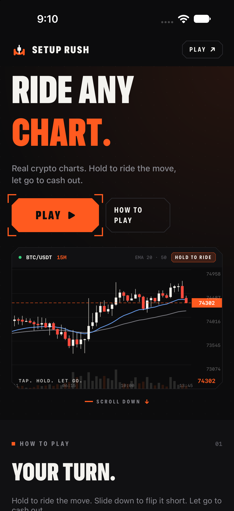

# Setup Rush — iPhone (native clone)

A native SwiftUI iPhone app that recreates [setuprush.com](https://setuprush.com): the same dark HUD landing page, the same **hold-to-ride** trading game on real recorded candles, Candle Vision setups, six modes and a bot arena.



## What it is

| Screen | What it does |
|---|---|
| **Landing** | Hero (`RIDE ANY / CHART.`), live scrolling chart, interactive hold-to-ride practice strip, setup-calling card, modes, markets, bot arena, chart carousel |
| **Play hub** | Rank tile, ticker, DEMO/ON-CHAIN switch, PRO card, bot arena, six modes, eight markets |
| **Game** | Full-screen paper chart with black HUD blocks, hold to open, slide down to flip short, release to cash out, live P&L, setups drawn with entry/stop/2R target |
| **Results** | P&L, win rate, trade list, equity reel, XP, share, play again / new chart |
| **Patterns** | 24 candlestick setups with hand-drawn glyphs and quick rules |
| **Career** | Rank, level, XP ladder, lifetime stats, last-run reel (persisted) |

### Core loop

1. A random 15-minute window of **real Coinbase candles** is replayed. Nothing prints before you play it.
2. Hold the chart → long at the live interpolated tick price. Slide down → flips short (Pro, Sniper, Blow-Up). Release → cash out and lock the P&L.
3. Candle Vision detects a setup on each close and names it **forming → confirmed**, drawing entry, stop and a 2R target.
4. Riding a confirmed setup in its direction tags the trade with the pattern name.

### Modes

| Mode | Rules |
|---|---|
| Rush | Spot, long only, 1× |
| Pro | Perps, long + short flips, 25× |
| Blow-Up | $1,000 bank, leverage ramps 25× → 100×, liquidation ends the run |
| Call It | Call the direction on each named setup, three lives, points instead of P&L |
| Sniper | One trade, 10×, 90s |
| Career | Rush rules, feeds the rank ladder |

Bot Arena races four indicator bots (EMA cross, RSI, Bollinger, pattern bot) against you on the same chart.

## Build & run

```bash
open SetupRush.xcodeproj      # Xcode 16+/26, iOS 17+
# or:
xcodebuild -project SetupRush.xcodeproj -scheme SetupRush \
  -sdk iphonesimulator -destination 'platform=iOS Simulator,name=iPhone 16' build
```

No packages, no network calls at runtime — everything is on device.

## Data

`SetupRush/Resources/markets.json` — 8 markets × 1,706 real 15-minute candles from Coinbase Exchange (BTC, ETH, SOL, DOGE, LINK, AVAX, XRP, SUI), fetched at build time and bundled. Regenerate with `tools/fetch_markets.py` (needs network).

Charts are recorded history; trades are simulated. No wallet, no on-chain, no real money.

## Structure

```
SetupRush/
  SetupRushApp.swift      app entry, routing, career recording
  Theme.swift             palette, condensed display type, HUD components
  Models.swift            candles, markets, modes, setups, career persistence
  PatternEngine.swift     24-pattern detector + bot strategies
  GameEngine.swift        playback, intrabar interpolation, position/P&L, modes
  ChartView.swift         Canvas candlestick renderer (paper + dark styles)
  LandingView.swift       landing page + live practice strip
  PlayHubView.swift       play hub, ticker, mode/market cards
  GameView.swift          the game screen, hold gesture, HUD, results trigger
  ResultSheet.swift       results + equity reel
  PatternsView.swift      pattern library
  CareerView.swift        rank ladder and stats
tools/
  fetch_markets.py        rebuilds markets.json from Coinbase
  make_icon.swift         regenerates the app icon
```

## Debug launch flags

```bash
xcrun simctl launch <device> com.setuprush.clone -screen hub
xcrun simctl launch <device> com.setuprush.clone -screen game -mode pro -autoride 1
```

`-autoride 1` drives a long → flip short → release sequence automatically (used for the screenshots).

## Known gaps vs the web app

- No on-chain wallet, live matches, reels feed or shop — this is the single-player game and its UI.
- 24 patterns shipped of the 64 the site lists; detection is heuristic, not the site's exact engine.
- Bot Arena is four local bots, not 169 Pine indicators.
- Eight markets instead of 174.

MIT. Not affiliated with Setup Rush; built as a UI/mechanics clone.
